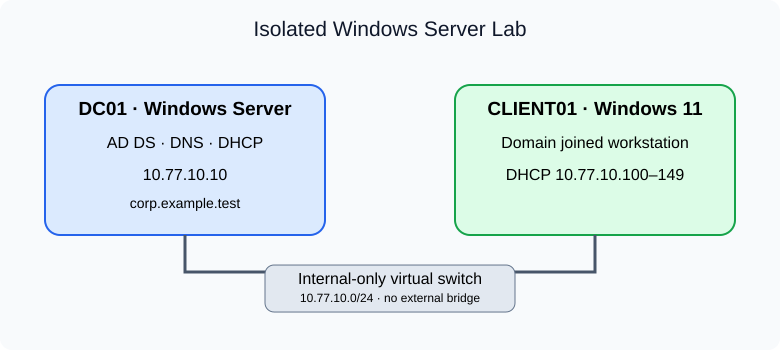

# Windows Server Infrastructure Lab

**Active Directory · DNS & DHCP · Group Policy · PowerShell automation**

A systems administration portfolio project focused on Windows Server, Active Directory Domain Services (AD DS), identity provisioning, network services, and PowerShell automation. Includes six provisioning and audit scripts, a Windows validation workflow, and deployment and recovery runbooks.

[Project guide](windows-server-infrastructure-lab/README.md) · [Deployment runbook](windows-server-infrastructure-lab/docs/deployment.md) · [Testing & evidence](windows-server-infrastructure-lab/docs/validation.md)



**Implementation status:** Scripts, CI configuration, and operational documentation are implemented. Windows deployment, CI execution, and backup/restore validation are pending. See the [validation record](windows-server-infrastructure-lab/docs/validation.md).

## Technical skills

Windows Server 2022/2025 · Active Directory Domain Services (AD DS) · Domain Name System (DNS) · Dynamic Host Configuration Protocol (DHCP) · Group Policy Objects (GPO) · Windows PowerShell 5.1 · Organizational Units (OU) · Security Groups · CSV User Provisioning · GitHub Actions · PSScriptAnalyzer · Hyper-V Lab Design · Windows Server Backup · System-State Recovery Planning

## Project highlights

- **Identity automation:** CSV-based user provisioning with username, duplicate, department, and required-field validation; disabled accounts and department-based group assignment.
- **Directory organization:** Scripts for four protected organizational units and three global security groups, with existence checks for repeated setup.
- **Network services:** AD-integrated DNS provisioning and a 50-address DHCP scope with domain authorization, adapter binding, and inactive initial state.
- **User policy:** A scoped Group Policy Object for screen-saver activation, password protection, and a 15-minute timeout.
- **Operations:** Directory audit exports, deployment instructions, a live validation checklist, an incident template, and system-state backup/recovery planning.
- **Code quality:** Windows CI configuration for PowerShell parsing and four selected PSScriptAnalyzer rules.

## Lab design

| Infrastructure | Identity & policy | Automation & operations |
| --- | --- | --- |
| AD DS forest with integrated DNS | Four protected organizational units | Six parameterized PowerShell scripts |
| Isolated DHCP scope with 50 addresses | Three departmental security groups | CSV validation before user creation |
| Domain-joined Windows client | Disabled-by-default users and user screen-lock GPO | Directory audit export and recovery runbook |

## Get started

Use Windows Server 2022 or 2025 and a Windows 11 Pro/Enterprise client on an isolated virtual switch. Run provisioning commands in elevated Windows PowerShell 5.1 on DC01. See the [deployment runbook](windows-server-infrastructure-lab/docs/deployment.md) for VM setup, domain creation, DHCP activation, and client enrollment.

```powershell
cd windows-server-infrastructure-lab
.\scripts\01-Install-LabDomain.ps1 -DomainName 'corp.example.test' -Confirm
# After the server restarts, sign in as the lab domain administrator.
.\scripts\02-Initialize-Directory.ps1 -Confirm
.\scripts\03-Import-LabUsers.ps1 -CsvPath .\examples\users.example.csv -Confirm
```

## Explore the repository

| Location | What you’ll find |
| --- | --- |
| [Scripts](windows-server-infrastructure-lab/scripts/) | Domain provisioning, directory setup, user import, DHCP, GPO, and audit export |
| [Documentation](windows-server-infrastructure-lab/docs/) | Architecture, deployment, live validation, recovery, and incident record |
| [Sample users](windows-server-infrastructure-lab/examples/users.example.csv) | Three fictional identities for repeatable provisioning |
| [Evidence tracker](windows-server-infrastructure-lab/evidence/README.md) | Expected artifacts and publication guidance |
| [Static checks](windows-server-infrastructure-lab/tests/README.md) | PowerShell syntax and analyzer checks |
| [GitHub Actions](.github/workflows/powershell.yml) | Windows-hosted validation without infrastructure provisioning |
| [Resume wording](windows-server-infrastructure-lab/docs/resume.md) | Current deliverables and evidence-backed deployment bullets |

## Portfolio summary

**Developed a Windows Server administration lab with six PowerShell scripts covering AD DS provisioning, directory organization, CSV-based user onboarding, DHCP configuration, Group Policy, and audit export. Added Windows CI configuration and operational runbooks for deployment, validation, and system-state recovery.**

Use the [resume-ready project entry](windows-server-infrastructure-lab/docs/resume.md) for your resume or LinkedIn Projects section.

## Engineering evidence

Record actual outcomes in the [validation checklist](windows-server-infrastructure-lab/docs/validation.md). Static checks cannot establish domain health or recovery success. This single-domain-controller lab demonstrates administration workflows; high availability and an enterprise security baseline are outside its scope.

## License

[MIT](windows-server-infrastructure-lab/LICENSE).
